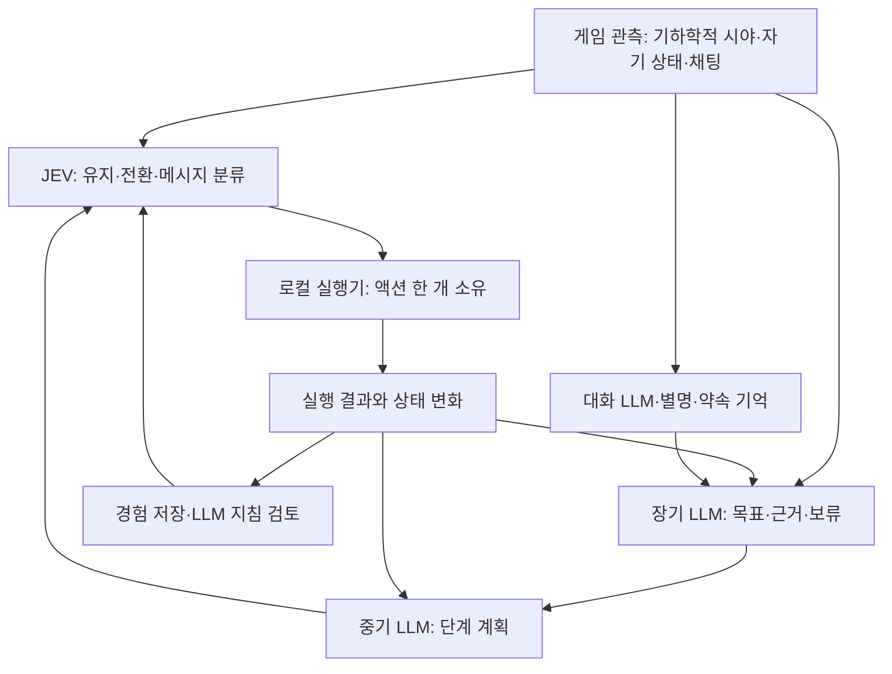

# Minecraft 자율 에이전트: 구현과 검증 과정

최신 후속: [실행 지속성 수정·재검증](CONTINUITY.md). 과거 파일럿 수치는 해당 당시 구현·환경의 결과이며, 최신 결과와 혼합하지 않습니다.
생성 모델의 계획, 빠른 JEV 행동 선택, Mineflayer 로컬 실행을 결합해 여러 봇이 관측·행동·대화·기억을 이어가는 프로젝트입니다. 세부 목표와 역할을 미리 지정하기보다 봇이 목표를 만들고 결과를 바탕으로 수정하도록 설계했습니다. 현재는 기능검증과 통합 파일럿 단계이며, 사람처럼 플레이하는 완성된 에이전트나 자율 사회의 재현을 주장하지 않습니다.

## 출발점과 선택

초기 v1은 Python 컨트롤러와 NeoForge 클라이언트 모드, Baritone 연결을 사용했습니다. 이후 API 기반 다중 봇 실행을 위해 v2를 별도로 구현했습니다. Mineflayer는 게임 프로토콜·기본 동작을, pathfinder는 경로 탐색을 제공합니다. 이 프로젝트는 그 위의 관측 제한, 스킬 실행/취소, 결과 검증, 모델 간 제어, 목표와 기억, 평가 도구를 구현합니다. 모든 이동·클릭을 처음부터 학습한 시스템은 아닙니다.

현재 A 버전은17종의 사전 정의 스킬을 사용합니다. 기본 조작만으로 배우는 B 버전은 설계 단계입니다. 액션 수를 늘리기보다 mine 통합, 공통 수거기, 컨테이너 입출금 재사용으로 실행 계약을 정리했습니다.

## 현재 구조

역할별 호출은 비동기로 진행하되 같은 역할의 요청을 중복하지 않습니다. 모델이 응답할 때 관측·계획 세대를 다시 확인하고 오래된 실행 지시는 폐기합니다. 실행 결과는 단순 성공 문자열 대신 실제 상태 변화로 기록합니다.

## 핵심 시행착오

| 문제 | 선택한 접근 | 관측한 결과와 한계 |
|---|---|---|
| 모델 지연과 전투 제어 | 빠른 선택과 로컬 추적·쿨다운 실행 분리, 신뢰도에 의한 행동 차단 제거 | 움직이는 좀비 처치를 확인했지만 다양한 적의 전투 능력은 미검증 |
| 성공한 명령과 실제 획득의 차이 | 블록 파괴·드롭 관측·인벤토리 증가 분리 | 유리/돌/판자 사례를 서버와 대조; 드롭 미관측은 드롭 없음으로 단정하지 않음 |
| 기억을 최신 사실로 취급 | 관측 시각·출처, 현재 시야와 과거 장소 구분 | 재접속 기억 확인; 장거리 탐색 성공과는 별개 |
| 계획을 기다리느라 행동 정체 | JEV·중기·장기·대화 독립 루프와 단일 실행 소유권 | 실제 호출 병렬성 확인; 장시간 행동 정체는 여전히 남음 |
| 회수 뒤 옛 보류 판단 유지 | 물자 부족분·회수 결과·판단 이력과 목표 재검토 연결 | 모의검증·기존 실제 기록 재생 완료; 위험 지역 추가 검증 필요 |
| 서버에 오래 접속하면 잘 플레이한 것처럼 보임 | 봇 내부 활동 계측과 서버 위치·소지품 교차 확인 |15분 완주 중 한 봇의8분31초 실질 작업 정체 발견 |

문제별 원인·시도·해결·검증·미해결 상태는 [시행착오 기록](ENGINEERING_LOG.md)에 정리했습니다. 실패한 시도도 남기며 후속 수정은 같은 이슈 ID에 연결합니다.

## 현재 증거

- 타입 검사와235개 모의검증을 통과했습니다. 이 문서 정리 작업에서 게임/API를 재실행하지 않았습니다.
- 제한된 실제 서버에서 이동·채굴·설치·제작·먹기·상자/화로·장비·전투·대화·리스폰/회수를 검증했습니다. 항목별 검증 조건은 상세 문서에 있습니다.
- 최신15분 자율 파일럿은 새 기억·세부 목표 없음·자연 스폰 OFF·초기 음식 제공 조건입니다. Alice는 기본 도구를 만들었고 Bob과 마지막 작업대 근처에 모였습니다. 공동 제작·자원 전달은 확인되지 않았습니다.
- 실행 비용은 약$1.30(JEV $0.742, GPT $0.558), API 전송 오류·사용량 미확인0건입니다. 설정 단가와 응답 사용량 기반 추정이며 공급자 청구서가 아닙니다.
- 작업대13개 반복 설치, 완료 목표 갱신 오류, 파괴 전 채굴 취소124건, Bob의8분31초 정체가 남았습니다. 성능 개선 전후의 통제 비교실험은 아직 하지 않았습니다.

[최신 파일럿과 한계](INTEGRATION.md) · [실행 구조](CONTROL_LOOP.md) · [v1 보존 기록](../../LEGACY.md)

## 다음 개발과 포트폴리오 활용

우선순위는 목표 전환, 작업 지속, 봇별 진전 감지, 기존 작업대 재사용과 기억 검토 오류입니다. 이후 고정된 초기 조건·기간·기억 조건에서 반복 실행하고 성공률·정체·실패 반복·대화의 행동 연결·비용을 비교해야 합니다.

포트폴리오에서는 기능 목록보다 **문제를 관측하고 가설을 세운 뒤 코드·실제 서버로 검증한 과정**을 제시합니다. 사용자 요구·설계 판단, AI 코딩 에이전트의 구현/분석 지원, 서버 관리자의 환경 준비·독립 관측을 구분합니다. 코드를 모두 수작업으로 작성했다거나 관측되지 않은 협동·학습 효과를 달성했다고 표현하지 않습니다. 공개 자료에는 키·서버 정보·원본 대화·개인 운영 로그를 포함하지 않습니다.

후속: MC-039 목표 재확인 처리와 장기 오류 피드백을 수정하고 타입 검사/241개 모의검증을 통과했습니다. 위15분 수치는 수정 전 결과이며 실제 개선 효과는 아직 측정하지 않았습니다.

후속 검증은 [CONTINUITY.md](CONTINUITY.md)에 연결합니다. wait 이름 변경만으로 해결되지 않은 사례, 계획 밖 후보, 표시용 오류 요약과 내부 판정의 혼용, 모델 입력 축약과 실행 검증의 혼용, 경로 조회 API의 공유 상태 간섭을 실제 실패에서 추적했습니다. 성공 회차만 선택해 보고하지 않습니다.

최신 반례: 새 기억·동일 최소 물자·근거리 협동 조건에서 대화 합의는 발생했으나 목표 근거 연결 실패로 한 봇이 작업하지 못했다. 약142초에 중단했고 성공 사례로 세지 않는다. [협동 파일럿과 미해결 수정안](COOP_PILOT.md)

최신 수정은 사회적 메시지와 목표 근거의 계약, 채굴 완료 단계, 시각 관측과 실질 진행의 구분, 작업대 없는 제작 재시도 조건을 다룬다. 실패 재현 테스트부터 확인하고286개 모의검증·타입 검사 및 실제 재검증을 수행했다. 최신 결과와 비용은 [협동 파일럿 후속](COOP_PILOT.md)에 기록한다. 잘못된 모델 응답을 검증·피드백으로 회복하는 것과 모든 응답이 처음부터 정확한 것은 구분한다.

후속 개선은 실행 없음의 원인을 API 지연·호출 간격·계획 소진으로 나눠 측정했다. 한 단계 계획 유도와 비동기 보충의 연결 문제를 수정하고, 실패한 실제 시도도 남겼다. [계획 보충과 idle 측정](PLAN_PREFETCH.md). 행동 시간이 늘어도 생산성이 늘었다는 뜻은 아니므로 실제 결과·실패도 함께 기록한다.

후속 탐색은 LLM 계획과 JEV의 구체적 대상 선택을 분리한다. 합성 API 검증에서 대상 선택15/15와 허기 우선1/3을 함께 기록했다. 실제 플레이 성능 주장이나 기본 정책 전환은 아직 하지 않았다. [대상 선택 검증](TARGET_SELECTION.md).
